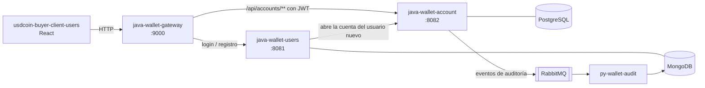

# java-wallet-users

[](https://github.com/josejps84/java-wallet-users/actions/workflows/ci.yml)

Servicio de **usuarios y autenticación** de la billetera:
- Registra usuarios y, al hacerlo, les abre su cuenta en el servicio de cuentas.
- Valida credenciales y emite el **JWT** que usan el gateway y el servicio de cuentas.



| Repo | Rol |
|---|---|
| [java-wallet-gateway](https://github.com/josejps84/java-wallet-gateway) | Punto de entrada único; valida el JWT y enruta |
| **java-wallet-users** | Registro, login y emisión de JWT (este repo) |
| [java-wallet-account](https://github.com/josejps84/java-wallet-account) | Cuentas y movimientos |
| [py-wallet-audit](https://github.com/josejps84/py-wallet-audit) | Guarda los eventos de auditoría |
| [usdcoin-buyer-client-users](https://github.com/josejps84/usdcoin-buyer-client-users) | Interfaz web |

## Stack

Java 25 · Spring Boot 4.1 (Web MVC, Security, Data MongoDB, Validation) · MongoDB 8 · BCrypt · JJWT · Lombok · JUnit 5, Mockito y Testcontainers.

## Arquitectura

Arquitectura hexagonal (puertos y adaptadores). El paquete raíz es `com.wallet.auth`:

```
src/main/java/com/wallet/auth
├── domain
│   ├── model            User, UserType, UserAuthType, excepciones
│   └── ports
│       ├── in           CreateUserUseCase, AuthenticateUserUseCase
│       └── out          UserRepositoryPort, PasswordEncoderPort, TokenProvider, AccountRegistrationPort
├── application/services UserService: implementa los casos de uso
└── infrastructure
    ├── adapters/in/web        UserController, DTOs, GlobalExceptionHandler
    ├── adapters/out/db        Repositorio Mongo, generador de ids, BCrypt
    ├── adapters/out/accounts  Cliente HTTP del servicio de cuentas
    ├── security               JwtTokenProvider
    └── config                 Spring Security
```

## Flujos

**Registro** (`POST /api/users/register`):
1. Se normaliza el email (sin espacios, en minúsculas) y se comprueba que no exista. Además hay un índice único en Mongo por si dos registros llegan a la vez.
2. Se guarda el usuario con la contraseña hasheada con BCrypt y un `userId` numérico secuencial.
3. Se llama a `java-wallet-account` (`POST /api/accounts/new`) autenticado con un JWT emitido para el usuario nuevo, para que la cuenta quede a su nombre.
   - Solo se reintentan los errores de red: 2 reintentos, a 1 s y 2 s.
   - Si la cuenta no se puede crear, **el usuario se borra** y se responde **502**, para que pueda volver a intentarlo.

**Login** (`POST /api/users/login`): si el email y la contraseña coinciden, devuelve un JWT. Si no, responde **401** con el mismo mensaje en los dos casos, para no revelar qué emails existen.

El JWT lleva:

| Claim | Ejemplo | Uso |
|---|---|---|
| `sub` | `jane@example.com` | Email del usuario |
| `userId` | `42` | Dueño de las cuentas |
| `userType` | `CUSTOMER` / `ADMIN` | Rol |
| `exp` | — | Expiración (24 h por defecto) |

## API

| Método | Ruta | Body | Respuesta |
|---|---|---|---|
| `POST` | `/api/users/register` | `{ "identification", "name", "email", "password" }` | **201** `{ "userId", "identification", "name", "email" }` |
| `POST` | `/api/users/login` | `{ "email", "password" }` | **200** `{ "token": "..." }` |

Validaciones del registro:
- `email` válido.
- `password` de 8 a 72 caracteres.
- `identification` y `name` obligatorios.

Cualquier otra ruta responde 403. La contraseña o su hash nunca aparecen en una respuesta ni en los logs.

Los errores siguen [RFC 9457](https://www.rfc-editor.org/rfc/rfc9457) (`ProblemDetail`):

| Código | Cuándo |
|---|---|
| 400 | Validación (`detail` lista los campos inválidos) |
| 401 | Credenciales inválidas |
| 409 | El email ya está registrado |
| 502 | El servicio de cuentas no pudo abrir la cuenta |

## Configuración

Por variables de entorno. Para correrlo en local se pueden poner en un archivo `.env` en la raíz del repo (está en `.gitignore`; ver [`.env.example`](.env.example)).

| Variable | Obligatoria | Default | Descripción |
|---|---|---|---|
| `JWT_SECRET` | sí | — | Secreto HMAC compartido con account y gateway (mínimo 32 bytes) |
| `MONGODB_URI` | no | `mongodb://localhost:27017/wallet` | Conexión a MongoDB (con credenciales si Mongo tiene auth) |
| `ACCOUNTS_BASE_URL` | no | `http://localhost:8082` | Servicio de cuentas, llamado directamente (sin pasar por el gateway) |
| `JWT_EXPIRATION_MS` | no | `86400000` | Duración del token |
| `SERVER_PORT` | no | `8081` | Puerto HTTP |

## Ejecutar en local

Requisitos: **JDK 25** (Lombok todavía no soporta versiones más nuevas) y Docker.

```sh
# 1. MongoDB
docker run -d --name wallet-mongo -p 127.0.0.1:27017:27017 \
  -e MONGO_INITDB_ROOT_USERNAME=admin -e MONGO_INITDB_ROOT_PASSWORD=<password> mongo:8

# 2. Configuración
cp .env.example .env
# JWT_SECRET=...
# MONGODB_URI=mongodb://admin:<password>@localhost:27017/wallet?authSource=admin

# 3. Arrancar
./mvnw spring-boot:run
```

Para que el registro funcione, `java-wallet-account` tiene que estar corriendo en `ACCOUNTS_BASE_URL`.

### Docker

```sh
docker build -t wallet-users .
docker run -p 8081:8081 -e JWT_SECRET=... -e MONGODB_URI=... -e ACCOUNTS_BASE_URL=http://<account>:8082 wallet-users
```

## Tests

```sh
./mvnw test
```

- **Unitarios:**
  - `UserService`: registro, rollback y login.
  - `JwtTokenProvider`: claims, expiración y rechazo de secretos cortos.
  - BCrypt y mappers (el DTO nunca expone la contraseña).
  - Cliente HTTP de cuentas contra un servidor real: no reintenta errores HTTP y reintenta 2 veces los de red.
- **Integración** (`AuthApplicationTests`): levanta MongoDB con Testcontainers y prueba registro y login, el rollback, los ids secuenciales, el índice único de email y los claims del token. Si no hay Docker disponible, se saltan solos.

El [workflow de CI](.github/workflows/ci.yml) corre `./mvnw verify` en cada push a `main` y en cada pull request.
